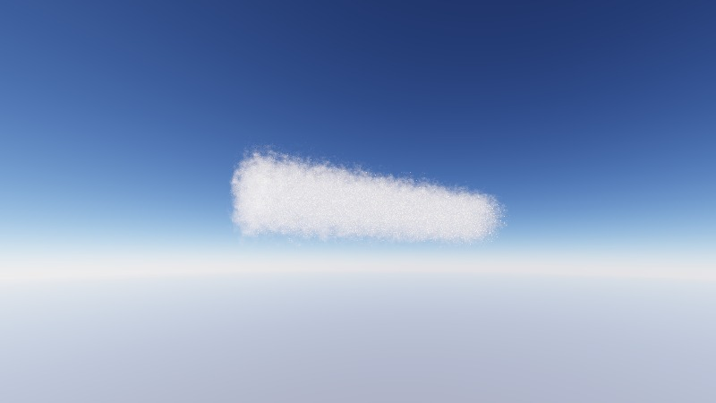
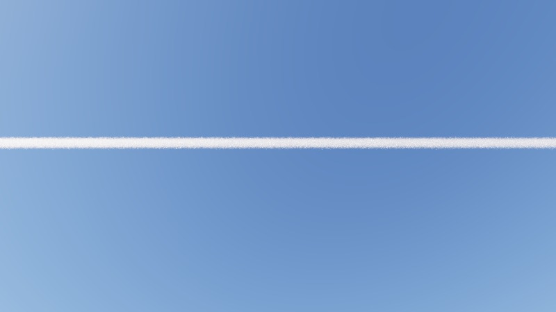
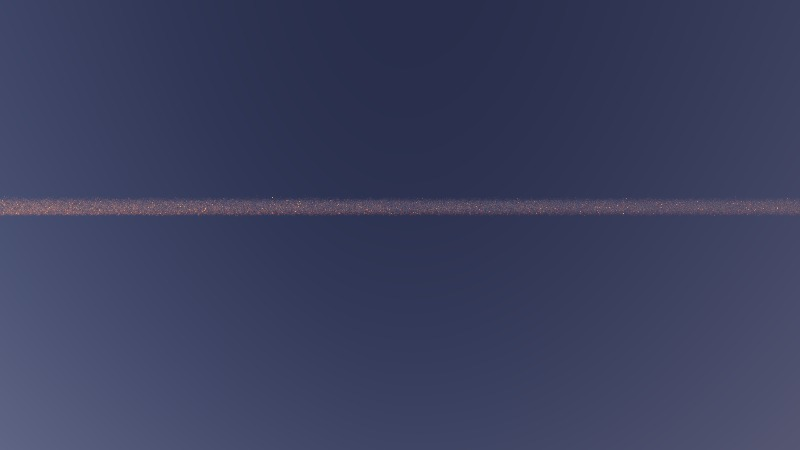
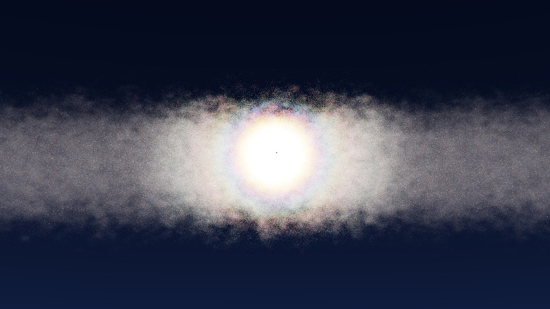
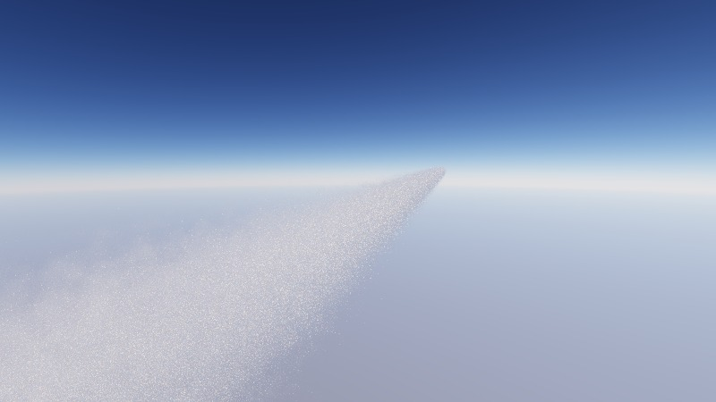

# contrail-render — rendu photoréaliste de traînées de condensation

Rendu physique (Monte Carlo spectral) d'une traînée de condensation décrite par
un fichier **CGNS** contenant la concentration de cristaux de glace (#/m³) et
leur rayon moyen (m), dans un **ciel physique** (Rayleigh, aérosols, ozone,
ombre de la Terre), de jour comme au crépuscule.

| Jour, vue latérale | Jour, depuis le sol |
|---|---|
|  |  |
| **Crépuscule** (soleil à −1,5°) | **Couronne** de diffraction autour du soleil |
|  |  |
| **Le long de la traînée** (20 km) | |
|  | |

*Rendus CPU 800×450, 128 échantillons/pixel, scènes de `examples/`.*

Deux outils :

- **`contrail-viewer`** : visualisation interactive, caméra libre dans le domaine, rendu progressif ;
- **`contrail-render`** : rendu haute résolution (4K, 8K, 16K… par tuiles) → PNG, TIFF 16 bits, TIFF float32 linéaire.

Le même code tourne **sur CPU et sur GPU** (CUDA ou Vulkan) grâce à
[Taichi](https://www.taichi-lang.org/) : seule l'option `--arch` change.

---

## Sommaire
1. [Installation](#1-installation)
2. [Démarrage rapide](#2-démarrage-rapide)
3. [Cas d'utilisation](#3-cas-dutilisation)
4. [Viewer interactif](#4-viewer-interactif)
5. [Données d'entrée (CGNS)](#5-données-dentrée-cgns)
6. [Paramètres de scène](#6-paramètres-de-scène)
7. [Sorties](#7-sorties)
8. [Modèle physique](#8-modèle-physique)
9. [Validation et tests](#9-validation-et-tests)
10. [Performances](#10-performances)
11. [Limites connues](#11-limites-connues)
12. [Organisation du code](#12-organisation-du-code)
13. [Références](#13-références)

---

## 1. Installation

### Sur un cluster (conda via `module`)

```bash
bash setup.sh                 # module load miniconda/23.1.0, crée l'env "contrail", installe le paquet
source activate.sh            # active l'environnement (à refaire à chaque session / job)
```

Variantes :

```bash
ENV_PREFIX=/scratch/$USER/envs/contrail bash setup.sh   # env hors du $HOME (quota)
CONDA_MODULE=miniconda/24.1.2 bash setup.sh             # autre nom de module
PRECOMPUTE=1 bash setup.sh                              # + tables de Mie + tests
```

`setup.sh` indique en fin d'exécution si les back-ends **CUDA** et **Vulkan**
sont disponibles. Le back-end CUDA n'a besoin que du pilote NVIDIA (pas du
CUDA toolkit). Lancer `setup.sh` sur un nœud GPU permet de vérifier CUDA.

### Installation manuelle

```bash
conda create -n contrail python=3.11      # Python 3.9 à 3.12 (Taichi 1.7)
conda activate contrail
pip install -e ".[test]"
```

### Premier lancement
Le premier rendu calcule les **tables de Mie** (≈ 3 min sur 8 cœurs, une fois
pour toutes, en cache dans `$CONTRAIL_CACHE` ou `~/.cache/contrail_render`) et
compile les kernels (≈ 1 min, en cache Taichi). Sur un cluster, on peut les
précalculer sur un nœud de login :

```bash
contrail-mie                     # sigma_g = 1.3 (défaut)
contrail-mie --sigma-g 1.1 1.3   # plusieurs largeurs de distribution
```

---

## 2. Démarrage rapide

```bash
source activate.sh

# rendu d'essai sur CPU (≈ 1 min)
contrail-render --arch cpu --width 640 --height 360 --spp 32

# viewer interactif (GPU)
contrail-viewer

# toutes les scènes d'exemple
bash examples/run_examples.sh
```

Les images sont écrites dans `renders/`. Sans `--cgns`, le fichier
`ressources/contrail.cgns` est utilisé. `render.py` et `viewer.py` à la racine
sont des alias de `contrail-render` et `contrail-viewer`.

---

## 3. Cas d'utilisation

Toutes les options s'obtiennent avec `contrail-render --help`. Une option en
ligne de commande prime sur la valeur du fichier `--scene`.

### 3.1 Scènes d'exemple

| Scène | Description |
|---|---|
| `examples/day_side.json` | jour, caméra à l'altitude de la traînée, vue latérale du domaine |
| `examples/day_ground.json` | jour, observateur au sol, traînée de 40 km (champ répété) à 10,5 km |
| `examples/dusk_ground.json` | crépuscule : soleil sous l'horizon au sol (−1,5°), traînée encore éclairée |
| `examples/corona.json` | couronne de diffraction : soleil vu à travers une traînée fine |
| `examples/along_contrail.json` | vue plongeante le long de la traînée (20 km), qui fuit vers l'horizon |

```bash
contrail-render --scene examples/day_ground.json  --width 3840 --height 2160 --spp 256
contrail-render --scene examples/dusk_ground.json --width 3840 --height 2160 --spp 512
bash examples/run_examples.sh corona dusk_ground                 # seulement certaines scènes
ARCH=cpu W=800 H=450 SPP=64 bash examples/run_examples.sh        # sur CPU, basse résolution
```

### 3.2 Très haute résolution

Le rendu est fait par tuiles (`--tile`, 1024 px par défaut), donc la mémoire GPU
ne dépend pas de la résolution finale :

```bash
# 8K
contrail-render --scene examples/day_ground.json --width 7680 --height 4320 --spp 1024
# 16K, tuiles de 2048 px
contrail-render --scene examples/day_ground.json --width 15360 --height 8640 --spp 512 --tile 2048
```

Sur un cluster SLURM (adapter les lignes `#SBATCH`) :

```bash
sbatch examples/slurm_render.sh examples/day_ground.json
W=15360 H=8640 SPP=512 sbatch examples/slurm_render.sh examples/dusk_ground.json
```

### 3.3 Position du soleil : jour, crépuscule

L'élévation du soleil est définie au niveau de la traînée. Une élévation
négative signifie que le soleil est couché pour un observateur au sol, alors
que la traînée à 10 km peut encore être éclairée (jusqu'à ≈ −3,3°).

```bash
contrail-render --scene examples/day_ground.json --sun-elevation 60 --sun-azimuth 200   # midi
contrail-render --scene examples/day_ground.json --sun-elevation 5                      # soleil bas
contrail-render --scene examples/day_ground.json --sun-elevation -1.5 --ev -2           # crépuscule
contrail-render --scene examples/day_ground.json --sun-elevation -2.5 --ev -3           # fin de crépuscule
```

Au crépuscule, l'exposition automatique ramène le ciel à un gris moyen.
`--ev -2` donne un rendu plus proche d'une photographie, ciel sombre et
traînée lumineuse.

### 3.4 Placer la caméra

Repère local = repère du CGNS en mètres, `z` vers le haut. Le sol est à
`z = −altitude`. `yaw` est compté depuis +x vers +y, `pitch` est positif vers le haut.

```bash
# depuis le sol, 6 km à côté de la trace, regard vers le haut
contrail-render --tile-x 20 --taper 4000 --camera 20000 -6000 -10490 --yaw 90 --pitch 58 --fov 50
# dans la traînée
contrail-render --camera 1000 0 0 --yaw 0 --pitch 0 --fov 90
# vue d'avion au-dessus, regard vers le bas
contrail-render --camera 1000 -800 1500 --yaw 90 --pitch -55 --fov 60
# téléobjectif (champ de 10°)
contrail-render --scene examples/day_ground.json --fov 10
```

Le plus simple reste de cadrer dans le viewer et de sauver la vue (touche `O`),
puis de rendre le JSON obtenu (cf. [§ 4](#4-viewer-interactif)).

### 3.5 Diffraction et couronnes

La couronne est d'autant plus marquée que la distribution de tailles est étroite
(`--sigma-g` proche de 1) et la traînée optiquement fine :

```bash
contrail-render --scene examples/corona.json                                # sigma_g = 1.1, densité x0.3
contrail-render --scene examples/corona.json --sigma-g 1.05 --fov 25        # anneaux plus nets
contrail-render --scene examples/corona.json --sigma-g 1.5                  # auréole sans anneaux
```

Chaque nouvelle valeur de `--sigma-g` déclenche le calcul d'une table de Mie
(≈ 3 min, une seule fois). On peut la précalculer avec `contrail-mie --sigma-g 1.05`.

### 3.6 Études de sensibilité (microphysique, optique)

```bash
contrail-render --scene examples/day_ground.json --crystal sphere     # sphères de Mie pures
contrail-render --scene examples/day_ground.json --crystal rough      # hybride (défaut), cf. § 8.2
contrail-render --scene examples/day_ground.json --density-scale 2    # N x 2
contrail-render --scene examples/day_ground.json --albedo 1.0         # albédo imposé
contrail-render --scene examples/day_ground.json --aerosol-scale 3    # atmosphère turbide
contrail-render --scene examples/day_ground.json --ground-albedo 0.8  # sol enneigé
contrail-render --scene examples/day_ground.json --altitude 12000     # traînée plus haute
```

### 3.7 Utiliser son propre fichier CGNS

```bash
contrail-render --cgns /chemin/simu.cgns --arch cuda --width 1920 --height 1080
contrail-render --cgns simu.cgns --up-axis y        # si l'axe vertical du CGNS est y
contrail-render --cgns simu.cgns --tile-x 10 --taper 3000   # domaine périodique en x : traînée longue
```

Si les champs ne portent pas les noms par défaut, renseigner `number_field`,
`radius_field` (et éventuellement `zone`) dans un JSON de scène :

```bash
contrail-render --scene examples/day_side.json --name test   # écrit renders/test.json (scène complète)
# éditer renders/test.json : "cgns", "number_field": "Nice", "radius_field": "Rice", "zone": "Base/Zone1"
contrail-render --scene renders/test.json
```

### 3.8 Utilisation depuis Python

```python
import taichi as ti
from contrail_render import app, scene
from contrail_render.renderer import auto_exposure, tonemap

ti.init(arch=ti.cuda)
sc = scene.Scene.from_json("examples/day_ground.json")
rd = app.load(sc, app.default_cache_dir(), 1920, 1080)
for _ in range(32):
    rd.render_pass(sc.camera, 1920, 1080, spp=8)
xyz = rd.get_xyz(1920, 1080)                 # radiance CIE XYZ, tableau [x, y] (y vers le haut)
rgb = tonemap(xyz, auto_exposure(xyz))       # sRGB [0, 1]
rd.set_sun(-1.0, 180.0)                      # recalcule le ciel, réinitialise l'accumulation
```

---

## 4. Viewer interactif

```bash
contrail-viewer                                     # GPU, fenêtre 1280x720, résolution interne /2
contrail-viewer --arch cuda --width 1920 --height 1080 --scale 1
contrail-viewer --scene examples/dusk_ground.json   # partir d'une scène
contrail-viewer --arch cpu --width 960 --height 540 --scale 4   # sans GPU
contrail-viewer --hires-width 15360 --hires-height 8640 --hires-spp 512   # réglages de la touche H
```

| Touche | Action |
|---|---|
| clic gauche + souris | orienter la caméra |
| `W` `A` `S` `D` / `E` `Q` | avancer, gauche, reculer, droite / monter, descendre |
| molette ou `Z` / `X` | vitesse ×2 / ÷2 |
| flèches (`Maj` = ×5) | élévation / azimut du soleil (1°) |
| `-` / `=` | exposition −/+ 0,5 EV |
| `F` / `G` | champ de vision −/+ 5° |
| `1` `2` `3` `4` | résolution interne = fenêtre / n |
| `O` | sauver la vue (scène JSON complète) dans `views/` |
| `P` | capture de l'aperçu courant dans `renders/` |
| `H` | sauver la vue **et** lancer le rendu haute résolution en tâche de fond |
| `Échap` | quitter |

L'image s'affine tant que la caméra est immobile, et tout changement relance
l'accumulation. Pendant un déplacement, le rendu passe à demi-résolution.
La vue sauvée (`O` ou `H`) fige l'exposition courante, si bien que le rendu
haute résolution a la même luminosité que l'aperçu.

```bash
contrail-render --scene views/view_20261028_160000.json --width 7680 --height 4320 --spp 1024
```

Sur un nœud de cluster sans écran, le viewer demande un affichage
(`ssh -X`, session VNC ou bureau distant). `contrail-render` fonctionne sans affichage.

---

## 5. Données d'entrée (CGNS)

Le fichier est lu avec `h5py` (CGNS ≥ 3, format HDF5). Ce qui est attendu :

- une **zone structurée** (`ZoneType = Structured`), grille **rectiligne**
  (x ne dépend que de i, etc.). Une grille étirée est rééchantillonnée
  automatiquement sur une grille uniforme ;
- un `FlowSolution_t` en `Vertex` ou en `CellCenter` contenant :
  - la concentration en nombre de cristaux, **#/m³** (noms reconnus : `IceNumberDensity`, `NumberDensity`, `n_ice`, `N_ice`, `Nice`) ;
  - le rayon moyen des cristaux, **m** (noms reconnus : `IceMeanRadius`, `MeanRadius`, `r_ice`, `R_ice`, `Rice`) ;
- les coordonnées en **mètres**.

Les autres champs (par ex. `IceWaterContent`) sont ignorés. Le fichier fourni,
`ressources/contrail.cgns`, est une grille 161×97×97 de 2000×600×600 m
(N_max = 2,3·10⁸ /m³, r_max = 5,1 µm), périodique en x.

---

## 6. Paramètres de scène

Un fichier de scène JSON (cf. `examples/`) contient tous les paramètres. Les
noms entre parenthèses sont les options équivalentes de la ligne de commande.

| Paramètre | Défaut | Rôle |
|---|---|---|
| `cgns` (`--cgns`) | `ressources/contrail.cgns` | fichier d'entrée (chemin relatif : répertoire courant, puis dossier du JSON et son parent) |
| `zone`, `number_field`, `radius_field` | auto | zone et noms des champs dans le CGNS |
| `up_axis` (`--up-axis`) | `z` | axe vertical du CGNS |
| `density_scale` (`--density-scale`) | 1 | multiplie la concentration |
| `tile_x` (`--tile-x`) | 1 | répétitions du champ (périodique) selon x |
| `taper` (`--taper`) | 0 | longueur d'estompage aux extrémités [m] |
| `sigma_g` (`--sigma-g`) | 1.3 | écart-type géométrique de la distribution log-normale des tailles |
| `crystal` (`--crystal`) | `rough` | `sphere` (Mie pur) ou `rough` (Mie + cristaux rugueux, § 8.2) |
| `rough_hg`, `rough_blend` | `[0.40, 0.90, 0.996]`, `[10, 20]` | paramètres du modèle `rough` |
| `albedo_override` (`--albedo`) | −1 | < 0 : albédo de Mie de la glace (≈ 0,99999) |
| `n_wavelengths` (`--wavelengths`) | 32 | bandes spectrales 380–780 nm (multiple de 4) |
| `delta_m_angle` | 5 | troncature δ-M du pic avant [°] (0 = désactivée) |
| `altitude` (`--altitude`) | 10500 | altitude de l'origine du CGNS [m] |
| `sun_elevation`, `sun_azimuth` | 25, 120 | position du soleil [°] (azimut depuis +x vers +y) |
| `aerosol_scale` (`--aerosol-scale`) | 1 | turbidité (épaisseur optique des aérosols) |
| `ozone_du` | 300 | colonne d'ozone [Dobson] |
| `ground_albedo` (`--ground-albedo`) | 0.15 | albédo du sol |
| `max_bounces` | 512 | nombre maximal de diffusions par chemin |
| `exposure_ev` (`--ev`) | 0 | correction d'exposition [EV] |
| `auto_exposure`, `exposure` | true, −1 | exposition automatique ou fixe (figée par le viewer) |
| `camera` (`--camera`, `--yaw`, `--pitch`, `--fov`) | | position [m], cap, site, champ vertical [°] |

---

## 7. Sorties

`contrail-render --name NOM --out DOSSIER` écrit :

| Fichier | Contenu |
|---|---|
| `NOM.png` | sRGB 8 bits, tone mapping ACES |
| `NOM_16bit.tif` | sRGB 16 bits, même tone mapping |
| `NOM_xyz.tif` | **radiance linéaire** CIE XYZ en float32, sans tone mapping (luminance en cd/m² = 683 × Y) |
| `NOM.json` | scène complète utilisée, exposition figée : relancer avec `--scene NOM.json` reproduit l'image |

Le TIFF XYZ permet un post-traitement quantitatif : luminance, contraste
traînée/ciel, autre tone mapping.

---

## 8. Modèle physique

### 8.1 Optique de la traînée
- **Coefficient d'extinction local** :
  `β_ext(x, λ) = N(x) · σ_ext(r̄(x), λ)`, avec `σ_ext` moyenné sur une
  distribution log-normale de moyenne arithmétique `r̄` et d'écart-type
  géométrique `σ_g`. N et N·r̄ sont interpolés trilinéairement.
- **Théorie de Lorenz–Mie** (`contrail_render/mie.py`) : algorithme de Bohren &
  Huffman, indice complexe de la glace (Warren & Brandt 2008), 32 bandes
  spectrales. Le code est validé contre `miepython` (écart < 10⁻⁸ jusqu'à x = 1500).
- **Diffraction** : la solution de Mie la contient exactement. La fonction de
  phase est tabulée tous les 0,01° de 0 à 5° et tous les 0,05° de 160 à 180°,
  ce qui produit couronnes et irisations autour du soleil, de jour comme au crépuscule.
- **Albédo de diffusion simple** ≈ 1 : celui de Mie pour la glace (≥ 0,99996
  dans le visible), ou une valeur imposée.

### 8.2 Forme des cristaux : modèle hybride `rough` (défaut)
Les sphères de Mie diffusent dix fois trop peu sur le côté
(p(90°) ≈ 0,003 sr⁻¹) par rapport à de vrais cristaux non sphériques et
rugueux (≈ 0,02–0,04 sr⁻¹, Yang et al. 2013, Baum et al. 2014). Avec des
sphères, une traînée vue sous un angle de diffusion de 60 à 130° (crépuscule,
soleil de côté) paraît beaucoup trop sombre.

Pour de grands paramètres de taille, la diffusion se sépare en :
- **diffraction**, qui ne dépend que de l'aire projetée, donc quasiment pas de la forme ;
- une partie **optique géométrique** (réfractions, réflexions), qui dépend de la forme.

Le modèle `rough` garde donc Mie sous 10° (pic de diffraction, couronnes) et le
remplace au-delà de 20° par une double Henyey–Greenstein
`q = w·HG(g1) + (1−w)·HG(−g2)`, avec un raccord continu entre 10 et 20°.
**L'énergie diffusée au-delà du raccord est exactement conservée**.
Extinction et albédo restent ceux de Mie, pour des sphères d'aire projetée
équivalente.

Les paramètres par défaut (g1 = 0,40, g2 = 0,90, w = 0,996) ont été ajustés pour
r = 4,5 µm : asymétrie totale g ≈ 0,74 (0,86 pour les sphères),
p(90°) ≈ 0,023 sr⁻¹ (×8,5), p(180°) ≈ 0,038 sr⁻¹. Ce sont les valeurs
publiées pour des cristaux fortement rugueux dans le visible. **Il s'agit d'une
approximation paramétrique, pas d'un calcul de lancer de rayons sur des
cristaux hexagonaux.** Elle reste ajustable (`rough_hg`, `rough_blend`), et
`--crystal sphere` revient à Mie pur.

Effet mesuré sur la scène `dusk_ground` : contraste traînée/ciel de 1,57 à 2,0,
et teinte qui passe du gris-bleu au rose-orangé (chromaticité x de 0,285 à 0,313).

### 8.3 Transport de la lumière
Path tracing volumique sans biais : diffusion multiple complète, estimation
directe du soleil, ciel comme lumière d'environnement (papier 3 : Novák et al. 2018).

- **delta tracking** pour les distances de vol, **ratio tracking** pour les
  rayons d'ombre ;
- **longueur d'onde héro** : 4 longueurs d'onde par chemin (Wilkie et al.
  2014), *spectral tracking* (Kutz et al. 2017), MIS spectral sur la fonction de phase ;
- **ciel en variable de contrôle** : le ciel sans traînée est intégré de façon
  déterministe dans toutes les bandes, et le Monte Carlo n'estime que l'écart
  dû à la traînée. Le ciel est donc sans bruit dès le premier échantillon.
  Le disque solaire est traité à part, par ratio tracking ;
- **troncature δ-M** du pic de diffraction (< 5°), appliquée **uniquement après
  le premier événement de diffusion**. La diffusion simple (couronnes) reste
  exacte, et les « fireflies » de la diffusion multiple disparaissent : le 99,9ᵉ
  percentile de luminance est divisé par 5 à nombre d'échantillons égal.

### 8.4 Ciel et atmosphère
D'après Bruneton & Neyret (2008) et Hillaire (2020), en spectral :
- diffusion **Rayleigh** (λ⁻⁴, hauteur d'échelle 8 km) ;
- **aérosols** : Mie, Cornette–Shanks avec g = 0,8, hauteur d'échelle 1,2 km ;
- absorption par l'**ozone** (bande de Chappuis, qui donne les bleus du crépuscule) ;
- **diffusion multiple** atmosphérique (LUT de Hillaire) ;
- Terre sphérique (R = 6360 km), atmosphère jusqu'à 60 km, **ombre de la
  Terre**, sol lambertien éclairé par le soleil et le ciel ;
- **perspective aérienne** entre la caméra et la traînée ;
- disque solaire de 0,53° avec assombrissement centre-bord ;
- spectre solaire hors atmosphère tabulé.

La lumière qui éclaire la traînée est atténuée et rougie le long du trajet
atmosphérique (LUT de transmittance, vérifiée contre une intégration directe).

### 8.5 Image
Spectre → CIE XYZ (fonctions colorimétriques CIE 1931) → sRGB linéaire →
exposition (automatique ou fixe, ± EV) → tone mapping ACES → sRGB.

### 8.6 Pourquoi pas d'apprentissage (papier 2) ?
Le réseau RPNN (Kallweit et al. 2017) apprend à reproduire des rendus de
référence calculés par path tracing. Il ne s'entraîne pas sur des
photographies. Le path tracer fournit déjà cette référence. Des photographies
de traînées (Unsplash, non redistribuées ici) ont servi à la validation
visuelle (cadrages, couleurs, contrastes).

---

## 9. Validation et tests

```bash
python -m pytest -q tests                 # tous les tests (≈ 1 à 3 min)
python -m tests.test_mie                  # Mie vs miepython, normalisation, modèle rough
python tests/test_furnace.py              # four blanc sur CPU
python tests/test_furnace.py vulkan       # four blanc sur GPU (vulkan ou cuda)
```

- **Mie** : Q_ext, Q_sca et |S1|²+|S2|² comparés à `miepython` pour x de 0,5
  à 1500 (écart < 10⁻⁸). La quadrature angulaire des tables redonne Q_sca à
  10⁻⁴ près.
- **Four blanc** : avec un albédo de 1 et un environnement uniforme de radiance 1,
  la radiance doit valoir exactement 1 quelle que soit la densité. Le test
  utilise une densité ×5 (τ ≈ 13). Résultat : 1 à 0,05 % près sur CPU et sur
  Vulkan, ce qui valide le tracking, l'échantillonnage de la fonction de
  phase, le MIS spectral, la troncature δ-M et le modèle `rough`.
- **Transmittance atmosphérique** : la LUT est identique à une intégration
  directe à 10⁻³ près, du soleil au zénith à −3° sous l'horizon.

---

## 10. Performances

| Matériel | Scène | Temps |
|---|---|---|
| CPU 8 cœurs (WSL) | `day_side`, 800×450, 128 spp | ≈ 75 s |
| CPU 8 cœurs (WSL) | `day_ground`, 800×450, 128 spp | ≈ 60 s |
| CPU 8 cœurs (WSL) | `corona`, 800×450, 128 spp | ≈ 105 s |
| CPU 8 cœurs (WSL) | `along_contrail`, 800×450, 128 spp | ≈ 130 s |
| GPU RTX A2000 | à mesurer | attendu 50 à 100× plus rapide |

Le coût est proportionnel au nombre de pixels couverts par la traînée : le
ciel seul est presque gratuit. Pour des images finales, compter 256 à 1024 spp.
Au crépuscule, la lumière est très colorée et il faut plutôt 512 spp ou plus.

> **Windows** : si la carte gère aussi l'affichage, le watchdog (TDR, 2 s) peut
> interrompre un kernel trop long. Réduire alors `--batch` (échantillons par
> lancement) et/ou `--tile`.

---

## 11. Limites connues
- Pas de halo à 22°, qui exige le calcul de cristaux hexagonaux orientés. Le
  modèle `rough` ne restitue que le comportement moyen de cristaux rugueux.
- La polarisation est ignorée.
- La traînée n'ombre pas l'atmosphère (pas de rayons crépusculaires) et ne
  projette pas d'ombre sur le sol.
- Seules les grilles CGNS **structurées rectilignes** sont acceptées : une
  grille non structurée doit d'abord être interpolée sur une grille cartésienne.
- Le domaine est supposé assez petit pour que la courbure terrestre soit
  négligeable à l'intérieur. La courbure est prise en compte pour l'atmosphère,
  l'horizon et l'ombre de la Terre.

---

## 12. Organisation du code

```
setup.sh                    installation (conda / module), crée activate.sh
pyproject.toml              paquet Python, commandes contrail-render / -viewer / -mie
render.py, viewer.py        alias des commandes
contrail_render/
  cli_render.py             rendu haute résolution par tuiles
  cli_viewer.py             viewer interactif
  cli_mie.py                précalcul des tables de Mie
  app.py                    options communes, initialisation Taichi, chargement
  scene.py                  paramètres de scène (JSON)
  cgns_reader.py            lecture CGNS/HDF5
  mie.py                    Mie, tables, modèle hybride rough
  spectral.py               CIE, spectre solaire, ozone, Rayleigh, indice de la glace
  renderer.py               atmosphère + path tracer spectral (Taichi, CPU/GPU)
examples/                   scènes JSON, run_examples.sh, slurm_render.sh
tests/                      validation (Mie, four blanc)
docs/gallery/               images du README
ressources/contrail.cgns    cas d'exemple (champ LES périodique, 2000×600×600 m)
```

---

## 13. Références
- Bohren & Huffman (1983), *Absorption and Scattering of Light by Small Particles*.
- Warren & Brandt (2008), Optical constants of ice from the ultraviolet to the microwave, *JGR*.
- Novák et al. (2018), Monte Carlo methods for volumetric light transport simulation, *CGF* — papier 3.
- Kallweit et al. (2017), Deep Scattering, *ACM TOG* — papier 2.
- Kutz et al. (2017), Spectral and decomposition tracking for rendering heterogeneous volumes, *ACM TOG*.
- Wilkie et al. (2014), Hero wavelength spectral sampling, *CGF*.
- Bruneton & Neyret (2008), Precomputed atmospheric scattering, *CGF*.
- Hillaire (2020), A scalable and production ready sky and atmosphere rendering technique, *CGF*.
- Wiscombe (1980), Improved Mie scattering algorithms, *Applied Optics*.
- Wyman, Sloan & Shirley (2013), Simple analytic approximations to the CIE XYZ color matching functions, *JCGT*.
- Yang et al. (2013), Spectrally consistent scattering properties of ice crystals, *J. Atmos. Sci.*
- Baum et al. (2014), Ice cloud single-scattering property models with the full phase matrix, *JQSRT*.
